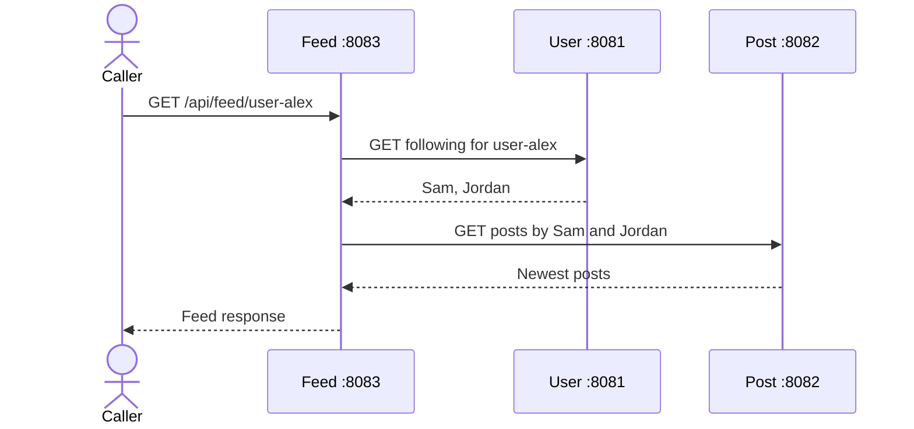
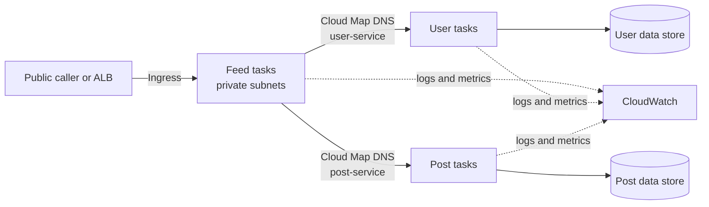
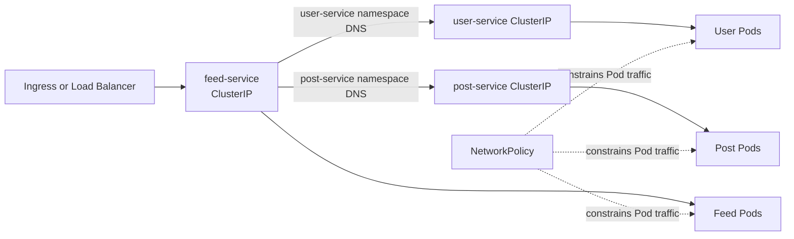
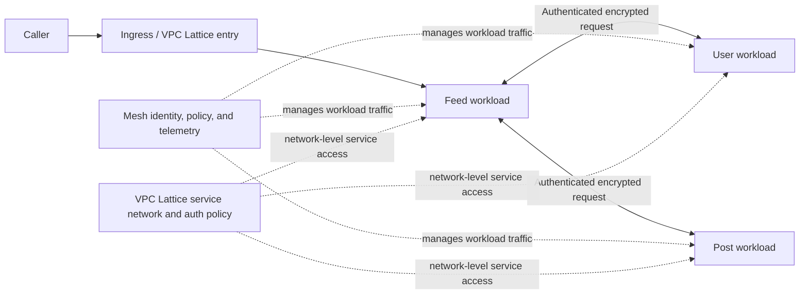

# Microservices Communication: From Local Development to AWS Production

## Four-Blog Series Plan

This series follows one request as PulseFeed grows from three local Spring Boot processes into cloud deployments and then adopts stronger traffic and identity controls. Each article builds on the same User, Post, and Feed responsibilities so readers can compare how communication changes as the runtime changes.

## Series sequence

| Part | Working title | Main question | State of the project |
| --- | --- | --- | --- |
| 1 · Local | **Building Microservices Communication from the Ground Up: A Practical Spring Boot Guide** | How does Feed call User and Post, and what happens when a call is slow or unavailable? | Implemented local baseline; see `BLOG-1-foundational-inter-service-communication.md`. |
| 2 · ECS | **Taking Microservices to AWS ECS: Service Discovery, Networking, and Secure Communication** | How do the same containers find and securely reach each other on ECS Fargate? | Planned deployment layer: Cloud Map, private networking, security groups, IAM, health checks, and CloudWatch. |
| 3 · EKS | **Microservices on AWS EKS: Kubernetes Networking, Service Discovery, and Communication Patterns** | How do Kubernetes Services and cluster DNS provide stable names while Pods change? | Planned deployment layer: Deployments, Services, DNS, NetworkPolicy, probes, and environment overlays. |
| 4 · Advanced | **Securing Microservices at Scale: Service Mesh, Mutual TLS, and AWS VPC Lattice** | How can service identity, authorization, traffic policy, and telemetry be managed consistently? | Planned comparison and extension: mesh-based mTLS and traffic controls alongside VPC Lattice service networking. |

## The application readers will follow

The current code has three independent Gradle applications. User Service owns user and follow data, Post Service owns posts, and Feed Service composes a feed by making synchronous OpenFeign calls. The two data-owning services keep data in memory, so a restart resets it. Feed's downstream locations are configured as URLs; the Feign client `name` values do not currently perform registry discovery.

```mermaid
flowchart LR
    Caller[Browser or API caller] -->|GET /api/feed/{userId}| Feed[Feed Service :8083]
    Feed -->|GET /api/users/{id}/following| User[User Service :8081]
    Feed -->|GET /api/posts?authorIds=...| Post[Post Service :8082]
    User --> UserData[(In-memory users and follows)]
    Post --> PostData[(In-memory posts)]
```

For the local request path, use the source of truth in the repo:

- `feed-service/.../feed/controller/FeedController.java` receives `/api/feed/{userId}`.
- `feed-service/.../feed/service/FeedService.java` gets followed users first, skips Post Service for an empty list, and maps a User Service 404 to a feed 404.
- `feed-service/.../feed/client/UserServiceClient.java` and `PostServiceClient.java` define the Feign HTTP contracts.
- Each service's `src/main/resources/application.properties` sets the port and context path. Feed reads configurable downstream base URLs.
- The projects use Gradle, Java 17, and Spring Boot 3.3.5. User and Post use Spring Web; Feed also uses Spring Cloud OpenFeign.

## Blog 1 — local communication

**Purpose:** establish the baseline and vocabulary used by the rest of the series.

**Story arc:** follow Alex's feed request; trace Feed → User → Feed → Post → Feed; inspect the Feign interfaces and local URLs; run the three services; stop a dependency and observe the error; explain timeout and retry choices as bounded policies.

**Diagram to include:** the flowchart above, plus a sequence diagram showing the order and the empty-following branch.



**Code accuracy note:** distinguish implemented behavior from suggested experiments. The current project has no custom Feign timeout or retry configuration and no service registry. Keep timeout property examples version-verified before presenting them as runnable configuration. The existing Blog 1 is the starting draft; revise its run commands against Gradle wrapper location before publication (each wrapper lives inside its own service directory).

## Blog 2 — AWS ECS Fargate

**Purpose:** preserve the application contracts while replacing laptop addresses with cloud service discovery and private network paths.

**Sections to write:** container/task definitions; private subnets and outbound access; Cloud Map namespaces and service registration; Feed-to-User/Post security group rules; task execution role versus task role; container health checks and ECS deployment health; CloudWatch logs/metrics; deploy and verify the same feed request.

**Diagram:**



**Repo alignment:** place ECS task/service definitions and network/security-group material under `infrastructure/aws/ecs/` and `infrastructure/aws/networking/`; keep deployable service code and Dockerfiles under each service; put runnable environment manifests under `deployment/ecs/`. Show exact files only after they exist. Explain that Cloud Map DNS discovery returns task endpoints; security groups still determine whether traffic is allowed. Keep task execution permissions (image/log plumbing) distinct from application task-role permissions.

## Blog 3 — AWS EKS

**Purpose:** explain Kubernetes-native service addressing and workload communication, then place the same application behind that model.

**Sections to write:** Deployments and replica management; ClusterIP Services as stable virtual endpoints; CoreDNS names; pod networking and CNI; readiness/liveness/startup probes; NetworkPolicy prerequisites and default-deny design; ingress/load balancer boundary; Kustomize `base/` and `overlays/dev|prod`; rollout, rollback, and capacity considerations.

**Diagram:**



**Repo alignment:** store common manifests under `deployment/eks/base/` and environment-specific patches under `deployment/eks/overlays/dev/` and `prod/`. Put cluster-specific infrastructure (VPC, cluster, node groups, IAM integration) under `infrastructure/aws/eks/`. Clarify that a Kubernetes Service gives a stable in-cluster destination; it is not the same component as AWS Cloud Map, and a NetworkPolicy only enforces rules when the selected cluster networking implementation supports it.

## Blog 4 — security and traffic management

**Purpose:** compare workload-level controls with application-level controls and explain where service mesh and VPC Lattice fit.

**Sections to write:** threat model and workload identity; TLS versus mutual TLS; certificate and identity lifecycle; authorization policies; retries/timeouts/circuit breaking and traffic shifting; telemetry correlation; service mesh data/control planes; VPC Lattice service networks, service associations, auth policies, and connectivity; decision guide for ECS, EKS, mesh, Lattice, and combinations.

**Diagram:**



**Repo alignment:** keep reusable security and architecture decisions under `infrastructure/aws/iam/`, `infrastructure/aws/networking/`, and `docs/decisions/`; put telemetry configuration in `observability/` and diagrams in `docs/diagrams/`. Avoid implying that a mesh and VPC Lattice are interchangeable: compare their operational scope, identity model, supported environments, and ownership boundaries using current AWS/product documentation when the post is written.

## Shared editorial and implementation rules

1. Carry the same Alex feed request and service responsibilities through all four posts.
2. Label code as **in the repo now**, **added in this part**, or **illustrative**. Do not present a future folder or AWS resource as already implemented.
3. Include one runnable verification path per post: local curl calls, ECS service/DNS checks, Kubernetes `kubectl` checks, then security/telemetry evidence.
4. Give each diagram a clear trust/network boundary, direction of calls, and named service. Keep diagrams close to the relevant explanation.
5. Recheck AWS service details, IAM guidance, Spring Cloud properties, and Kubernetes behavior against official documentation at publication time.
6. Add each finished article under `blogs/` using the numbered filenames from the proposed repository layout, and link the series parts to one another.

## Proposed publication file mapping

The current checkout is the `services/` directory and contains `BLOG-1-foundational-inter-service-communication.md`; it does not yet contain the larger `blogs/`, `infrastructure/`, or `deployment/` tree shown in the target layout. When that layout is introduced, use:

| Proposed file | Article |
| --- | --- |
| `blogs/01-local-development-communication.md` | Blog 1 |
| `blogs/02-aws-ecs-communication.md` | Blog 2 |
| `blogs/03-aws-eks-communication.md` | Blog 3 |
| `blogs/04-service-mesh-mtls-vpc-lattice.md` | Blog 4 |

Keep the existing draft until it is deliberately moved or consolidated; avoid two competing published copies of Part 1.
