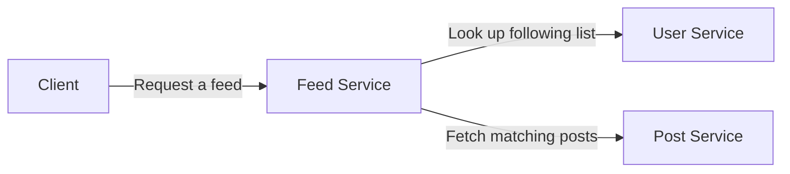

# Microservices Communication: From Local Development to AWS Production

*A practical four-part journey with Spring Boot, AWS ECS, AWS EKS, and production-grade service security.*

Microservices are easy to draw as boxes and arrows. The harder questions start when one service needs another: How does it find the right instance? What happens when a call is slow? Which workload is allowed to connect? And how do we see what happened when a request crosses several services?

I’m exploring those questions through **PulseFeed**, a small social-feed application built with three Spring Boot services:

- **User Service** manages users and follow relationships.
- **Post Service** manages posts.
- **Feed Service** combines the two to build a user’s feed.

The central request stays the same throughout the series: Feed Service receives a request, asks User Service who the user follows, then asks Post Service for those authors’ posts.



## Where things live in the repository

The repository is organized so application code, cloud infrastructure, deployment configuration, observability, and the articles each have a clear home. The examples in the series will point to these folders as the project grows:

```text
pulsefeed-platform/
├── services/                 # Spring Boot source, build files, and Dockerfiles
│   ├── user-service/         # User profiles and follow relationships
│   ├── post-service/         # Post creation and retrieval
│   └── feed-service/         # Feed API and clients for User and Post
├── infrastructure/           # Cloud resources and Terraform
│   ├── aws/ecs/              # ECS cluster, services, and task definitions
│   ├── aws/eks/              # EKS cluster and Kubernetes platform resources
│   ├── aws/networking/       # VPCs, subnets, routing, and security groups
│   ├── aws/iam/              # Roles and policies
│   └── aws/monitoring/       # AWS monitoring resources
├── deployment/                # How application versions are deployed
│   ├── docker-compose/       # Local multi-container environment
│   ├── ecs/                  # ECS service and task configuration
│   └── eks/                  # Kubernetes base manifests and dev/prod overlays
├── observability/             # OpenTelemetry, Prometheus, Grafana, dashboards
├── docs/                      # Architecture notes, decisions, and diagrams
├── blogs/                     # The articles in this series
└── .github/workflows/         # Build and deployment automation
```

In short, `services/` contains what we build; `infrastructure/` describes AWS resources; `deployment/` describes how the services run on each platform; `observability/` contains telemetry setup and dashboards; and `docs/` and `blogs/` explain the architecture and the learning journey. The full tree and code will be available at **[the PulseFeed GitHub repository](ADD_GITHUB_REPOSITORY_URL_AFTER_PUSHING)** after I publish it.

We’ll begin with the simplest version that works on a developer’s machine, then carry the same application into AWS deployment models and examine the security and traffic controls needed as the system grows. Each article will use the codebase and diagrams to connect the concepts to a concrete request path.

## The series

1. **Building Microservices Communication from the Ground Up: A Practical Spring Boot Guide** — Follow a synchronous REST request locally, configure service addresses, and understand timeouts, retries, and failure handling.
2. **Taking Microservices to AWS ECS: Service Discovery, Networking, and Secure Communication** — Run the services on ECS Fargate and explore Cloud Map discovery, private networking, security groups, IAM, health checks, and CloudWatch.
3. **Microservices on AWS EKS: Kubernetes Networking, Service Discovery, and Communication Patterns** — Use Kubernetes Services and internal DNS, then look at pod networking, network policies, and production deployment practices.
4. **Securing Microservices at Scale: Service Mesh, Mutual TLS, and AWS VPC Lattice** — Explore workload identity, mutual TLS, fine-grained access, traffic management, and observability.

The progression is deliberate: understand the call before adding infrastructure around it; understand the network before tightening access; then compare the tools that can apply identity, policy, and visibility across service boundaries.

## Start here

**Part 1: Building Microservices Communication from the Ground Up: A Practical Spring Boot Guide**

> Add the Medium link to Part 1 here after publishing.

I’ll update this introduction with links to each part as it is published.

---

*This series follows the PulseFeed codebase. The local version is a learning sandbox with in-memory data; cloud infrastructure and production controls are introduced and clearly identified in their respective articles.*
